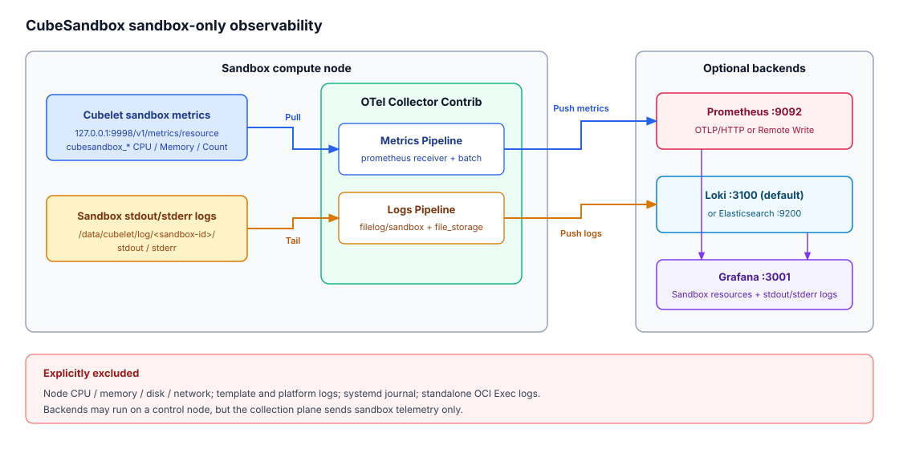

# CVM / 裸金属沙箱 OTel Collector 方案

## 1. 范围

`install.sh` 在每个 Cubelet 节点安装一个 `otelcol-contrib 0.162.0` systemd
服务，采集范围固定为：

- Cubelet `127.0.0.1:9998/v1/metrics/resource` 的 `cubesandbox_*` 沙箱资源指标。
- `/data/cubelet/log/<sandbox-id>/{stdout,stderr}` 中的沙箱标准输出/标准错误日志。

明确不采集：

- 节点 CPU、内存、磁盘或网络等宿主机资源指标。
- `/data/log` 下的模板或平台组件日志。
- systemd journal。
- 不新增 OCI Exec 独立日志路径；Exec 仍只保留现有实时输出。

后端可以使用本仓库一键安装的 Prometheus、Loki / Elasticsearch、Grafana，也可以
指向外部兼容服务。沙箱 stdout/stderr 默认和后续均建议使用 Loki；已有 ES 平台或
需要复杂全文检索时可改用 Elasticsearch。



## 2. 数据流

```text
Cubelet /v1/metrics/resource
  -> prometheus receiver
  -> memory_limiter -> resource labels -> batch
  -> otlp_http/metrics 或 prometheus_remote_write

/data/cubelet/log/<sandbox-id>/{stdout,stderr}
  -> filelog/sandbox receiver + file_storage cursor
  -> sandbox_id / stream 解析
  -> resource + flat attributes -> batch
  -> elasticsearch/logs 或 otlp_http/logs
```

指标和日志管道可以独立启用。至少配置一个输出端，脚本才会安装或渲染配置。

## 3. 安装与渲染

### 3.1 推送到 Prometheus + Loki（推荐）

```bash
sudo env \
  CUBE_OBSERVABILITY_CLUSTER_ID=cube-prod \
  CUBE_METRICS_OTLP_HTTP_ENDPOINT=http://10.0.0.10:9092/api/v1/otlp \
  CUBE_LOGS_OTLP_HTTP_ENDPOINT=http://10.0.0.10:3100/otlp \
  ./CubeObservability/deploy/one-click/otel-systemd/install.sh install
```

### 3.2 使用 Prometheus Remote Write

```bash
sudo env \
  CUBE_METRICS_REMOTE_WRITE_URL=http://10.0.0.10:9092/api/v1/write \
  CUBE_LOGS_OTLP_HTTP_ENDPOINT=http://10.0.0.10:3100/otlp \
  ./CubeObservability/deploy/one-click/otel-systemd/install.sh install
```

### 3.3 只渲染配置

```bash
env \
  CUBE_METRICS_OTLP_HTTP_ENDPOINT=http://10.0.0.10:9092/api/v1/otlp \
  CUBE_LOGS_OTLP_HTTP_ENDPOINT=http://10.0.0.10:3100/otlp \
  CUBE_OTEL_CONFIG_OUTPUT=/tmp/cubesandbox-otelcol.yaml \
  ./CubeObservability/deploy/one-click/otel-systemd/install.sh render
```

### 3.4 改用 Elasticsearch

将 `CUBE_LOGS_OTLP_HTTP_ENDPOINT` 替换为：

```bash
CUBE_LOGS_ES_ENDPOINT=http://10.0.0.10:9200
CUBE_LOGS_ES_INDEX=cubesandbox-logs
```

两个日志 endpoint 不能同时设置。

生成文件：

- 二进制：`/usr/local/bin/otelcol-contrib`
- 配置：`/etc/cube-sandbox/otelcol.yaml`
- Unit：`/etc/systemd/system/cube-sandbox-otelcol.service`
- filelog 游标与 OTLP 队列：`/var/lib/cube-sandbox/otelcol/storage`
- Prometheus Remote Write WAL：`/var/lib/cube-sandbox/otelcol/prom_rw`

## 4. 配置项

| 变量 | 默认值 | 说明 |
| --- | --- | --- |
| `CUBE_OBSERVABILITY_CLUSTER_ID` | `cubesandbox` | 集群标识 |
| `CUBE_METRICS_OTLP_HTTP_ENDPOINT` | 空 | 指标 OTLP/HTTP 基础地址，不含 `/v1/metrics` |
| `CUBE_METRICS_REMOTE_WRITE_URL` | 空 | Remote Write 地址，与指标 OTLP 二选一 |
| `CUBE_METRICS_AUTHORIZATION` | 空 | 指标输出的完整 `Authorization` 值 |
| `CUBE_METRICS_REMOTE_WRITE_TOKEN` | 空 | 指标 Bearer Token，与上一项二选一 |
| `CUBE_METRICS_TENANT_ID` | 空 | 指标输出的 `X-Scope-OrgID` |
| `CUBE_LOGS_ES_ENDPOINT` | 空 | Elasticsearch 地址 |
| `CUBE_LOGS_ES_INDEX` | `cubesandbox-logs` | Elasticsearch 索引名 |
| `CUBE_LOGS_ES_USER` / `CUBE_LOGS_ES_PASSWORD` | 空 | Elasticsearch Basic Auth；必须同时设置 |
| `CUBE_LOGS_ES_API_KEY` | 空 | Elasticsearch API Key；与 Basic Auth 二选一 |
| `CUBE_LOGS_ES_TLS_INSECURE_SKIP_VERIFY` | `false` | 是否跳过 ES TLS 证书校验，仅建议临时诊断使用 |
| `CUBE_LOGS_OTLP_HTTP_ENDPOINT` | 空 | 日志 OTLP/HTTP 基础地址，与 ES 二选一 |
| `CUBE_LOGS_AUTHORIZATION` | 空 | 日志 OTLP 输出的完整 `Authorization` 值 |
| `CUBE_LOGS_TOKEN` | 空 | 日志 OTLP Bearer Token，与上一项二选一 |
| `CUBE_LOGS_TENANT_ID` | 空 | 日志 OTLP 输出的 `X-Scope-OrgID` |
| `CUBE_LOGS_SANDBOX_ID` | `*` | 采集全部沙箱或限定一个沙箱 ID |
| `CUBE_LOGS_FILE_START_AT` | `beginning` | 首次读取位置：`beginning` / `end` |

鉴权值只接受单行内容；URL 必须使用 `http://` 或 `https://`。指标和日志的两个
候选输出端分别互斥，避免同一管道被意外重复发送。ES API Key 与 Basic Auth
不能同时设置；`CUBE_LOGS_ES_USER` 和 `CUBE_LOGS_ES_PASSWORD` 必须成对提供。

## 5. Receiver

### 5.1 `prometheus`

- 每 5 秒抓取 `http://127.0.0.1:9998/v1/metrics/resource`。
- `trim_metric_suffixes: false`，保留 Cubelet 原始指标名。
- 只抓 Cubelet 沙箱资源接口，不读取 `/proc`、`/sys` 等节点资源。

### 5.2 `filelog/sandbox`

- include：`/data/cubelet/log/${CUBE_LOGS_SANDBOX_ID}/{stdout,stderr}`。
- 正则从路径提取 `sandbox_id` 与 `stream`。
- 将路径、沙箱 ID 和 stdout/stderr 同时写入 OTel 资源属性和兼容 ES 查询的扁平字段。
- `start_at: beginning` 只影响首次发现；后续位置由 `file_storage` 游标恢复。

沙箱销毁时 Cubelet 会删除本地目录，因此 Collector 必须在沙箱存活期间持续 tail
并写入远端后端。

## 6. Processor 与字段

`memory_limiter` 限制 Collector 自身内存，`batch` 批量发送。资源和属性处理器写入：

| 字段 | 值 |
| --- | --- |
| `service.name` / `service_name` | `cubesandbox-sandbox` |
| `cubesandbox.log.source` / `cubesandbox_log_source` | `sandbox-init` |
| `cubesandbox.cluster.id` / `cubesandbox_cluster_id` | 集群 ID |
| `host.name` / `host_name` | 当前节点地址 |
| `cubesandbox.sandbox.id` / `cubesandbox_sandbox_id` | 路径中的沙箱 ID |
| `log.iostream` / `log_iostream` | `stdout` 或 `stderr` |
| `log_file_path` | 原始文件路径 |

资源属性由 Loki 保存为 label / structured metadata；扁平字段供 Grafana
Elasticsearch 变量和 Lucene 查询使用。

## 7. Exporter

- `otlp_http/metrics`：自动向基础地址追加 `/v1/metrics`，启用 gzip、持久队列和无限期重试。
- `prometheus_remote_write`：写入 `/api/v1/write`，使用本地 WAL。
- `elasticsearch/logs`：以 raw mapping 写入 `cubesandbox-logs`。
- `otlp_http/logs`：自动向基础地址追加 `/v1/logs`，使用持久队列。

完整生成示例见
[`../../../README_zh.md`](../../../README_zh.md#43-生成配置示例)。

## 8. 运行检查

```bash
sudo systemctl status cube-sandbox-otelcol.service
sudo journalctl -u cube-sandbox-otelcol.service -n 100 --no-pager
curl -fsS http://127.0.0.1:13133/
curl -fsS http://127.0.0.1:9998/v1/metrics/resource | grep '^cubesandbox_'
```

重新执行 `install` 会下载缺失版本、重写配置、执行 Collector `validate`，随后重启
服务。卸载命令：

```bash
sudo ./CubeObservability/deploy/one-click/otel-systemd/install.sh uninstall
```
