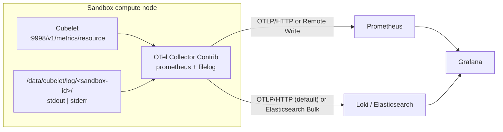

# CubeObservability and OTel Collector Design

## 1. Goals and boundaries

This design provides a uniform path for sandbox resource metrics and
standard-output/standard-error logs while keeping Cubelet lightweight,
allowing backend replacement, and leaving observability disabled by default in
standard deployments.

Collected data:

- sandbox CPU, memory, and instance-count metrics exposed by Cubelet
  `/v1/metrics/resource`;
- sandbox `stdout`/`stderr` logs under
  `/data/cubelet/log/<sandbox-id>/{stdout,stderr}`.

Out of scope:

- host CPU, memory, disk, and network metrics;
- control-plane, platform component, template-build, and systemd logs;
- separate OCI Exec log files, history queries, or Grafana dimensions;
- CubeAPI or SDK historical metrics and log-query APIs.

Prometheus, Grafana, and either Loki or Elasticsearch can be installed
together, but store and display only the sandbox data above. Loki is the
default and recommended log backend; Elasticsearch remains available.

## 2. Current data sources

### 2.1 Sandbox resource metrics

Cubelet exposes Prometheus text format at
`127.0.0.1:9998/v1/metrics/resource`:

| Metric family | Meaning |
| --- | --- |
| `cubesandbox_node_sandbox_count` | Sandboxes currently known by the HostSandbox sampler |
| `cubesandbox_node_sandbox_available_count` | Sandboxes with a fresh resource sample |
| `cubesandbox_host_sandbox_cpu_*` | Sandbox cgroup CPU time, limits, and throttling |
| `cubesandbox_host_sandbox_memory_*` | Sandbox cgroup current memory, limits, and failures |

The two node-count metrics are part of the current development change and are
not present in released `v0.7.0` through `v0.7.2`. Existing versions can
estimate a count from active resource series, but cannot return a stable zero
for an empty node.

The `host_sandbox` scope accounts for the sandbox host-side cgroup. It is not
whole-node monitoring. The Collector forwards this endpoint and does not read
additional host metrics from `/proc` or `/sys`.

### 2.2 Sandbox standard-output/standard-error logs

```text
/data/cubelet/log/<sandbox-id>/stdout
/data/cubelet/log/<sandbox-id>/stderr
```

CubeShim captures sandbox standard output (`stdout`) and standard error
(`stderr`), and the Cubelet path appends them to these files. Sandbox deletion
removes the directory, so a node Collector must tail the files while the
sandbox exists.

## 3. Recommended architecture



OTel Collector Contrib is used because its Prometheus receiver can scrape
Cubelet without changing Cubelet's reporting model, its filelog receiver
supports path parsing and durable offsets, and it supports all required
exporters across systemd and Kubernetes.

## 4. Collector pipelines

Metrics:

```text
prometheus receiver
  -> memory_limiter
  -> cluster and node resource labels
  -> batch
  -> otlp_http/metrics or prometheus_remote_write
```

Logs:

```text
filelog/sandbox
  -> extract sandbox_id and stdout|stderr from the path
  -> add OTel resource and flat Elasticsearch-compatible fields
  -> batch
  -> otlp_http/logs or elasticsearch/logs
```

The shared log contract includes:

| OTel / backend field | Meaning |
| --- | --- |
| `service.name` / `service_name` | `cubesandbox-sandbox` |
| `cubesandbox.log.source` / `cubesandbox_log_source` | `sandbox-init` |
| `cubesandbox.cluster.id` / `cubesandbox_cluster_id` | Cluster ID |
| `host.name` / `host_name` | Node IP or Kubernetes Node name |
| `cubesandbox.sandbox.id` / `cubesandbox_sandbox_id` | Sandbox ID |
| `log.iostream` / `log_iostream` | `stdout` or `stderr` |
| `log_file_path` | Original file path |
| `Body` | Log body |
| `@timestamp` | Collection timestamp |

## 5. Deployment mapping

| Topology | Collector | Optional backend |
| --- | --- | --- |
| First one-click node (all-in-one) | systemd Collector | Local Prometheus, Loki (default) or Elasticsearch, and Grafana |
| Additional one-click compute node | systemd Collector | Control node or explicit external endpoint |
| Kubernetes Helm | Compute-node DaemonSet | Chart-managed or external backend |
| Tencent Cloud Terraform | CVM compute-node systemd Collector only | Jumpserver or external backend |
| Existing systemd deployment | `CubeObservability/deploy/one-click/install.sh cvm` | Any compatible backend |
| Existing Kubernetes deployment | `CubeObservability/deploy/kubernetes/install.sh` | Any compatible backend |

All standard entry points are disabled by default. Enable with
`ONE_CLICK_ENABLE_OBSERVABILITY=1`, `observability.enabled=true`, or
`TENCENTCLOUD_ENABLE_OBSERVABILITY='true'` for one-click, Helm, and Terraform
respectively. See `CubeObservability/README.md` for shared settings and
`CubeObservability/deploy/kubernetes/README.md` for the standalone Kubernetes
Collector.

## 6. Grafana

The bundle provides:

- `cubesandbox-host-sandbox.json` for sandbox counts, CPU, memory, limits, and
  throttling;
- `cubesandbox-logs.json` for Loki / LogQL;
- `cubesandbox-logs-elasticsearch.json` for Elasticsearch / Lucene.

Both log dashboards filter `service_name=cubesandbox-sandbox`. Loki indexes only
the stable service, cluster, and host labels; the high-cardinality sandbox ID
is structured metadata.

## 7. Reliability and security

- systemd persists file offsets and OTLP queues under
  `/var/lib/cube-sandbox/otelcol/storage`;
- Kubernetes persists them per node under
  `/var/lib/cube-sandbox/otelcol-k8s`;
- Cubelet `:9998` has no built-in TLS or authentication and must remain on
  loopback or a trusted management network;
- the standalone Kubernetes installer stores configured metrics and log
  credentials in a Secret, while Helm references an existing Secret through
  `auth.existingSecret`;
- HTTPS endpoints verify the system trust store. Helm does not yet mount a
  custom CA Secret, so private-CA deployments must add that mount instead of
  disabling verification;
- log bodies may contain user data, so backend and Grafana access must be
  restricted.

## 8. Future work

Future additions require an explicit design and opt-in:

1. Cubelet, CubeMaster, and other platform component logs. Give each component
   a separate, disabled-by-default receiver/pipeline and follow the fields,
   mounts, and cardinality constraints in section 4.5 of
   `CubeObservability/README.md`.
2. CubeAPI / SDK historical metrics and log queries.
3. Sandbox rootfs capacity and page-cache metrics.
4. OCI Exec log persistence, retention, and authorization.
5. Capacity monitoring and cleanup for the Kubernetes Collector state path.

Every new source must update Collector configuration, the field contract,
bilingual documentation, Grafana dashboards, and regression tests.
