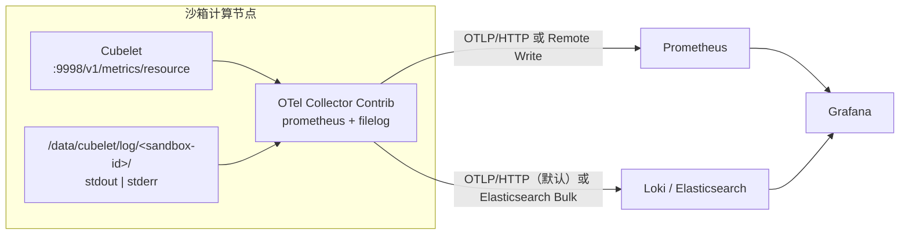

# CubeObservability 与 OTel Collector 方案

## 1. 目标

本方案为沙箱提供统一的资源指标和标准输出/标准错误日志采集链路，同时保持
Cubelet 轻量、后端可替换、标准部署默认关闭。

采集范围：

- Cubelet `/v1/metrics/resource` 暴露的沙箱 CPU、内存和实例计数。
- `/data/cubelet/log/<sandbox-id>/{stdout,stderr}` 中的沙箱标准输出/标准错误日志。

Prometheus、Grafana 和 Loki / Elasticsearch 日志后端可以一键部署，但只存储和
展示上述沙箱数据。Loki 是默认和推荐选择，Elasticsearch 保留为可选后端。

## 2. 当前数据源

### 2.1 沙箱资源指标

Cubelet 在 `127.0.0.1:9998/v1/metrics/resource` 暴露 Prometheus 文本格式：

| 指标族 | 含义 |
| --- | --- |
| `cubesandbox_node_sandbox_count` | 当前 HostSandbox 采样器清单中的沙箱数 |
| `cubesandbox_node_sandbox_available_count` | 当前有新鲜资源样本的沙箱数 |
| `cubesandbox_host_sandbox_cpu_*` | 沙箱 cgroup CPU 累计时间、限额和节流 |
| `cubesandbox_host_sandbox_memory_*` | 沙箱 cgroup 当前内存、限额和失败次数 |

默认 `host_sandbox` scope 表示按沙箱宿主侧 cgroup 记账，不等同于节点整体资源
监控。Collector 只转发该接口的数据，不额外读取 `/proc` 或 `/sys`。

### 2.2 沙箱标准输出/标准错误日志

```text
/data/cubelet/log/<sandbox-id>/stdout
/data/cubelet/log/<sandbox-id>/stderr
```

CubeShim 拉取沙箱的标准输出流（stdout）与标准错误流（stderr），并由
Cubelet 链路追加写盘。沙箱销毁时目录会被删除，因此需要节点 Collector 在沙箱存活
期间持续 tail 并写入远端日志后端。

## 3. 推荐架构




选择 OTel Collector Contrib 的原因：

- Prometheus receiver 可直接抓取 Cubelet，无需修改 Cubelet 上报逻辑。
- filelog receiver 支持路径解析和基于 `file_storage` 的读取游标。
- 同时支持 OTLP/HTTP、Prometheus Remote Write 和 Elasticsearch exporter。
- systemd 与 Kubernetes 使用同一数据模型和大部分配置。

## 4. Collector Pipeline

### 4.1 指标

```text
prometheus receiver
  -> memory_limiter
  -> cluster / node resource labels
  -> batch
  -> otlp_http/metrics 或 prometheus_remote_write
```

抓取配置：

```yaml
receivers:
  prometheus:
    trim_metric_suffixes: false
    config:
      scrape_configs:
        - job_name: cubesandbox-resource
          scrape_interval: 5s
          scrape_timeout: 3s
          metrics_path: /v1/metrics/resource
          static_configs:
            - targets: ["127.0.0.1:9998"]
```

### 4.2 日志

```text
filelog/sandbox
  -> 从路径提取 sandbox_id 和 stdout|stderr
  -> 写入 OTel resource + 兼容 Elasticsearch 查询的扁平字段
  -> batch
  -> elasticsearch/logs 或 otlp_http/logs
```

核心 receiver：

```yaml
receivers:
  filelog/sandbox:
    include:
      - /data/cubelet/log/*/stdout
      - /data/cubelet/log/*/stderr
    start_at: beginning
    storage: file_storage
    include_file_path: true
    operators:
      - type: regex_parser
        parse_from: attributes["log.file.path"]
        regex: '^/data/cubelet/log/(?P<sandbox_id>[^/]+)/(?P<stream>stdout|stderr)$'
```

标准字段：

| OTel / 日志后端字段 | 含义 |
| --- | --- |
| `service.name` / `service_name` | 固定为 `cubesandbox-sandbox` |
| `cubesandbox.log.source` / `cubesandbox_log_source` | 固定为 `sandbox-init` |
| `cubesandbox.cluster.id` / `cubesandbox_cluster_id` | 集群 ID |
| `host.name` / `host_name` | 节点 IP 或 Kubernetes Node 名 |
| `cubesandbox.sandbox.id` / `cubesandbox_sandbox_id` | 沙箱 ID |
| `log.iostream` / `log_iostream` | `stdout` 或 `stderr` |
| `log_file_path` | 原始文件路径 |
| `Body` | 日志正文 |
| `@timestamp` | 采集时间 |

## 5. 部署映射

| 形态 | Collector | 可选后端 |
| --- | --- | --- |
| one-click 第一台节点（默认 all-in-one） | systemd Collector | 本机 Prometheus + Loki（默认）或 Elasticsearch + Grafana |
| one-click 计算节点 | systemd Collector | 推送到控制节点或显式外部地址 |
| Kubernetes Helm | 计算节点 DaemonSet | Chart 内置后端或外部后端 |
| Terraform 腾讯云 | 仅 CVM 沙箱计算节点 systemd Collector | Jumpserver 后端或外部后端 |

所有标准部署入口默认关闭，通过以下配置启用：

- one-click：`.env` 中 `ONE_CLICK_ENABLE_OBSERVABILITY=1`
- Helm：`--set observability.enabled=true`
- Terraform：`.env` 中 `TENCENTCLOUD_ENABLE_OBSERVABILITY='true'`

日志后端通过 `CUBE_LOGS_BACKEND=loki|elasticsearch`（one-click / Terraform）
或 `observability.logs.backend`（Helm）选择；独立 Kubernetes Collector 则只配置
对应的 Loki OTLP 或 Elasticsearch endpoint。一次只启用一个日志后端。

通用配置、one-click 与独立 Kubernetes Collector 命令见
[可观测性部署指南](../guide/observability.md)。

## 6. Grafana

提供两张 sandbox-only 看板：

- `cubesandbox-host-sandbox.json`：沙箱数量、CPU、内存、限额与节流。
- `cubesandbox-logs.json`：默认 Loki / LogQL 看板，按 Cluster、Node、Sandbox ID、
  stdout/stderr 和正文正则检索沙箱标准输出/标准错误日志。
- `cubesandbox-logs-elasticsearch.json`：选择 Elasticsearch 时使用的 Lucene 看板。

两个日志看板都固定筛选 `service_name=cubesandbox-sandbox`，避免其他类型日志混入。
Loki 只索引 `service_name`、`cubesandbox_cluster_id`、`host_name`，Sandbox ID
保留为 structured metadata，避免高基数 stream。

## 7. 可靠性与安全

- systemd 形态将 filelog 游标和 OTLP 队列持久化到
  `/var/lib/cube-sandbox/otelcol/storage`。
- Kubernetes 按节点使用 `/var/lib/cube-sandbox/otelcol-k8s` hostPath 保存状态；
  同一节点上的 Pod 替换可恢复 filelog 游标和发送队列。
- Cubelet `:9998` 没有内置 TLS 或鉴权，只应监听回环地址或受信管理网络。
- systemd 形态的后端凭证通过环境变量注入；独立 Kubernetes 安装器将配置的指标和
  日志凭证写入 Secret；Helm 通过 `auth.existingSecret` 引用已有 Secret。
- HTTPS endpoint 默认验证系统信任链；Helm 当前未提供自定义 CA Secret 挂载，私有
  CA 场景需先扩展该能力，不能通过关闭证书校验代替。
- 日志正文可能含用户数据；应限制 Loki / Elasticsearch 与 Grafana 的网络访问和账号权限。

## 8. 扩展要求

扩展数据源时，应同时更新 Collector 配置、字段契约、双语文档、Grafana 看板和回归
测试；组件日志的 receiver、字段、挂载和高基数约束见
[可观测性部署指南](../guide/observability.md#45-扩展采集其他组件日志)。
